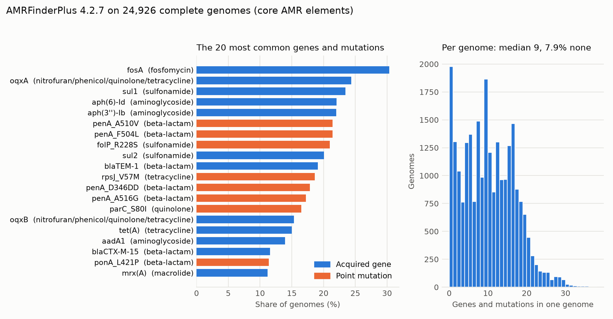

# Chapter: Data

*Muhammad Ali Mirza (data and evolution). Every number in this chapter comes from a script in the repository, named beside it, run on the files listed in section 1. The cleaning is versioned (`CLEAN_VERSION` in `experiments/lib/data_prep.py`); this chapter describes cleaning v7, the version every result in the Results chapter uses.*

## 1. Sources

All resistance data comes from **BV-BRC** (the Bacterial and Viral Bioinformatics Resource Center, https://www.bv-brc.org/), the public database that succeeded PATRIC. It holds, per bacterial genome and antibiotic, a resistance call and, for laboratory results, the measurement behind it.

| Dataset | What it is | Size | Built by | Used for |
|---|---|---|---|---|
| **AMR export** | Every AMR record in BV-BRC, downloaded 2026-09-28 from `bv-brc.org/api/genome_amr/` | 17,585,506 records, 36 CSV files, 4.9 GB | `scripts/bvbrc_download/download_amr_full.py` | Labels and metadata for every model |
| **Complete genomes** (Dataset 3) | The full assembly of every genome used by the genome models | 24,926 genomes (22,475 of them lab-tested), 11 GB of FASTA | `experiments/genome/features/download_genomes.py` | k-mer and gene features |
| More complete genomes | The other lab-tested genomes, downloaded in Colab straight to Google Drive | 64,812 genomes, about 76 GB gzipped | `notebooks/download_genomes_to_drive.ipynb` | k-mers built for 89,738 genomes; gene features pending (section 7) |
| **Genome metadata** | Collection year, country and host of every genome in the export | 449,286 of 449,320 genomes found | `scripts/bvbrc_download/download_genome_meta.py` | Temporal test, timeline ML model |
| **Published resistance curves** | Lab evolution of *E. faecalis* (Maltas, Huynh & Wood 2025, PLOS Biology) and carbapenem-resistant *K. pneumoniae* in 10 countries (ECDC EARS-Net, 2005 to 2024) | 15 curves | `Data/evolution_curves/` (sources, DOIs and licences in `sources.csv`) | Checking the timeline simulation |

Two earlier datasets were replaced and are kept only to reproduce the first models: **Dataset 1**, a 3,655-file subset of the AMR records (about 1.5 million rows after cleaning), and **Dataset 2**, the genome files the July k-mer model trained on. Dataset 2 turned out to be truncated: an *E. coli* file held about 0.8 MB of a 5 MB genome (genome 1090929.3: 25 of its 120 contigs), so a resistance gene outside the saved part could not be found. Dataset 3 replaces it with complete assemblies.

**Reproducibility.** Every download script is resumable and writes a manifest; the AMR export's manifest records BV-BRC's own row counts, and the download matched them exactly (1,285,111 lab and 16,300,395 computational records). The raw export and the cleaned table are shared on Google Drive, not in git. **Licence:** the reuse terms for BV-BRC's laboratory AMR records are not stated (BV-BRC-API issue #204 is unanswered), so the project publishes the code that rebuilds the cleaned table, not the table itself.

## 2. What one record is

One AMR record is a statement about one **genome** and one **antibiotic**: the resistance call (Resistant, Susceptible, Intermediate and a few rarer values), how it was obtained, and for laboratory results the measurement. The columns the cleaning reads:

| Column | Meaning |
|---|---|
| Genome ID | The BV-BRC genome, for example `562.7712` (taxon, dot, number) |
| Taxon ID, Genome Name | The organism; the name gives genus and species |
| Antibiotic | Free-text drug name |
| Resistant Phenotype | The call: Resistant, Susceptible, Intermediate, Nonsusceptible, Reduced Susceptibility, Susceptible-dose dependent |
| Measurement, Measurement Value, Measurement Unit | Usually an MIC in mg/L with a sign (`<=2`, `>16`); sometimes a disk-diffusion zone in mm |
| Evidence | **Laboratory Method** or **Computational Method** |
| Computational Method Performance | For computational calls, the F1 score of the method that made them |

**Laboratory and computational labels.** Only 1,285,111 of the 17.6 million records come from a laboratory. The other 16,300,395 were predicted by BV-BRC's own machine-learning models from the genome sequence (an XGBoost model for 7,218,911 rows, an AdaBoost classifier for 998,807; a third model, 8,082,677 rows, gives an MIC but no call). This matters twice. A genome model can score well on computational labels by re-learning BV-BRC's model, so genome results are quoted on laboratory rows. And the two kinds of label disagree: on the 463,429 genome-drug pairs that have both, they agree 90.4% of the time; 25,888 pairs are called susceptible by the computer and resistant by the lab (`experiments/audit/results/audit.md`, section 6).

## 3. Cleaning

`experiments/lib/data_prep.py` turns the raw export into one modelling table; `experiments/audit/audit_bvbrc.py` counts every problem it handles. The steps, in order:

| Step | What it does | Rows affected |
|---|---|---|
| Read | Only the 10 columns above; **Genome ID read as text** (section 4) | 17,585,506 records |
| Keep usable calls | Drop records with no resistance call. Most are lab measurements BV-BRC never turned into a call | 8,922,627 rows kept (50.7%) |
| Label | Resistant, Intermediate, Nonsusceptible and Reduced Susceptibility → **1**; Susceptible and Susceptible-dose dependent → **0**. Calling an intermediate isolate resistant is the safer error | |
| Antibiotic names | Lower-case and trim, then the alias map in `backend/amr_constants.py`: 31 spelling variants renamed (for example `amipicillin_sulbactam`, `cefalotin`), 10 non-drugs dropped (`carbapenem`, `beta-lactam`, `instrument`, ...). 156 names on rows with a call become 126 | 1,234,613 rows renamed, 45,167 dropped |
| Drug class | Each drug mapped to one of 23 classes (`DRUG_CLASS_MAP`) | |
| MIC | Split the measurement into a sign (`<=`, `>`, ...) and a value; add log(1 + MIC). **Zone diameters in mm are not MICs** and get no MIC (new in v7) | 8,380 lab rows in mm |
| Organism | Genus and species from the genome name; species-level taxon ID from NCBI (`experiments/build_taxonomy.py`) | |
| Provenance | `label_source` = lab or computational; for computational rows the method's F1 score, for lab rows 1.0 | |
| One row per genome and drug | When a pair has several records, keep one, a laboratory result first | 1,030,913 duplicate rows removed |

The result is cached as a pickle (`experiments/cache/clean_v7_amr_full_norm.pkl`, 1.5 GB) so experiments skip the cleaning. The cache name carries the cleaning version, so a changed cleaning can never be mixed with an old cache.

## 4. Data-quality problems found

The audit (`experiments/audit/audit_bvbrc.py`, about 2 minutes, output in `experiments/audit/results/audit.md`) counts every defect on the pinned export. The ones that changed results:

| Problem | Count | Effect if not handled | Handling |
|---|---|---|---|
| **Genome IDs read as numbers** | 32,744 of 449,320 IDs collide with another ID (`195.304` and `195.3040`); 43,596 IDs end in a zero | 16,531 genomes merge with others; a genome's rows land on both sides of a split | Read as text (cleaning v5) |
| **Taxon IDs mix ranks** | 12,597 of 13,042 taxon IDs are strains or serotypes; *E. coli* alone has 2,423 | The same species looks like thousands of organisms | Map each taxon to its species via NCBI |
| **Antibiotic spelling variants and non-drugs** | 196 raw names for 126 drugs | The same drug counted as two; drug classes recorded as drugs | Alias map (section 3) |
| **Records without a call** | 580,200 lab and 8,082,677 computational | None (dropped), but lab MICs that a breakpoint table could label are lost | Dropped; noted as future work |
| **Zone diameters stored as measurements** | 8,380 lab rows in mm | A 25 mm zone read as an MIC of 25 mg/L | No MIC for mm rows (v7) |
| **Conflicting results** | 4,313 lab pairs disagree with themselves; 44,683 pairs disagree between lab and computer | Contradictory labels | One row per pair, lab first |
| **Testing standard missing or inconsistent** | 232,793 lab rows with no standard; "CLSI" and "clsi" both used | Breakpoints cannot be checked | Recorded, not used as a feature |
| **Hidden collection years** | 31,577 lab-tested genomes (25.6%) have an empty `collection_year` but a year in `collection_date` | A quarter of the dated genomes would be lost | Year read from either field |
| **Plasmid-only records** | 207 of the 24,926 downloaded "genomes" are plasmids under 500 kb | Plasmids treated as whole genomes | `min_genome_bp: 500000` in every genome run |
| **Truncated genome files** (Dataset 2) | 2,587 genomes, many a fraction of the genome | Genes missed by AMRFinderPlus | Complete assemblies downloaded (Dataset 3) |

These matter for evaluation as much as for cleaning: the split by genome (Methodology chapter) is only as good as the Genome ID, and before cleaning v5 a merged ID put the rows of two genomes into one group. The prior-work check (`experiments/audit/results/prior_work_check.md`) found that BV-BRC's own data paper (VanOeffelen et al. 2021) reports sampling bias and stored zone diameters, but none of the identifier, naming, taxon or label problems above.

## 5. The cleaned data

Cleaning v7 of the complete export (computed from `clean_v7_amr_full_norm.pkl`):

| | All rows | Laboratory rows |
|---|---|---|
| Rows (genome-drug pairs) | **7,847,110** | **649,944** |
| Genomes | 439,542 | 87,325 |
| Resistant | 28.0% | 33.7% |
| With an MIC | 2.7% | 33.1% |
| Antibiotics / drug classes | 126 / 23 | |
| Genera / species-level taxa | 40 / 247 | |
| Rows per genome (median) | 20 | |

The data is uneven, and the models inherit it. *Escherichia* alone is 3.56 million rows, followed by *Salmonella* (1.08 million) and *Mycobacterium* (0.98 million); 15 genera hold almost every row. The resistant share differs widely by organism (*Salmonella* 15.1%, *Acinetobacter* 72.1%) and between label sources: for lipopeptides 95.4% of all rows are resistant but only 10.9% of lab rows, for monobactams 28.4% against 68.4%. Per-genus, per-class and per-drug tables are in `audit.md`, section 7.

**Collection years** (`experiments/audit/results/genome_meta_coverage.md`): 75,284 of the 87,325 lab-tested genomes have a year (571,202 of the 649,944 lab rows), median 2012. In the genome metadata, most dated lab-tested genomes were collected between 2005 and 2015, and only 2.2% in 2020 or later. That shapes the temporal test in the Results chapter: the most recent years are thin.

## 6. Genome features

**Complete assemblies.** For every lab-tested genome in the earlier cleaning, `download_genomes.py` fetched the full assembly from the BV-BRC API: 24,926 genomes, 0 failures, each checked against BV-BRC's listed length. After removing the 207 plasmid-only records, 24,719 genomes feed the genome models.

**k-mer counts** (`experiments/genome/kmers.py`). Each genome is read once and every 6-letter DNA word is counted: 4,096 counts per genome. Counting stays inside each contig (a word spanning two contigs is not real sequence), and any window with a base other than A, C, G or T is skipped. The file `kmer6_counts.npz` (199 MB) holds four arrays: genome ID, counts (24,926 × 4,096), length and GC content. Shorter words are sums of these counts, so the models can use 3-, 4- or 5-mers without reading the genomes again; the served model uses 4-mers. The same code, run in Colab on the genomes on Drive, produced counts for 89,738 genomes (`kmer6_counts_all.npz`, 715 MB).

**Resistance genes** (`experiments/genome/features/run_amrfinder.py`, `build_gene_matrix.py`). NCBI **AMRFinderPlus** 4.2.7, with database version 2026-08-07.1, searches each genome against NCBI's curated Reference Gene Database for known resistance genes and resistance point mutations, using the organism-specific mutation tables where AMRFinderPlus has them. *Mycobacterium tuberculosis*, which AMRFinderPlus has no organism option for, is searched without one: it gets its acquired genes but no point mutations. Only core AMR elements are kept. The result is a **gene matrix**: one row per genome, one 0/1 column per gene or mutation (format in `progress/formats/README.md` section 3).

| | Count |
|---|---|
| Genomes searched | 24,926 |
| With at least one gene or mutation | 22,949 (92.1%) |
| Columns | 2,733: 1,234 genes, 1,499 point mutations |
| Genes and mutations per genome | median 9, maximum 37 |
| Lab-tested genomes covered | 22,475 of 22,475 (201,042 lab rows) |

*Figure: the 20 most common genes and mutations, and how many each genome carries (`experiments/genome/features/gene_figure.py`). The most common element, fosA, is intrinsic to many Gram-negative species; the penA and ponA mutations are Neisseria's.*

## 7. Scaling to every lab-tested genome

The genome models learn from 22,475 of the 87,325 lab-tested genomes in the cleaned data, because only those were downloaded at first. The other 64,850 do not fit on a laptop (about 247 GB of DNA), so they were downloaded in Colab straight to Google Drive: 64,812 arrived; 38 were refused because BV-BRC sent less DNA than the genome's listed length (36 of them *M. tuberculosis* records). Their k-mers are built (89,738 genomes in all). AMRFinderPlus on them was started in Colab and, by the team's plan, retraining the genome models on all of them is future work. When it is done, the same AMRFinderPlus and database version must be used, so the models do not learn which batch a genome came from.

## 8. Limitations of the data

- **Most labels are computational.** 92.7% of the export was predicted by BV-BRC's models, not measured; results are therefore reported for laboratory rows separately.
- **The data is a convenience sample.** It reflects which genomes were sequenced and submitted: a few genera dominate, and the recent years are thin.
- **Lab measurements without a call are dropped.** Re-interpreting them with CLSI or EUCAST breakpoints would add labelled rows but needs the testing standard, which a third of the lab rows lack.
- **One cleaned table per version.** Results from different cleaning versions are not comparable; every run records the version it used.
