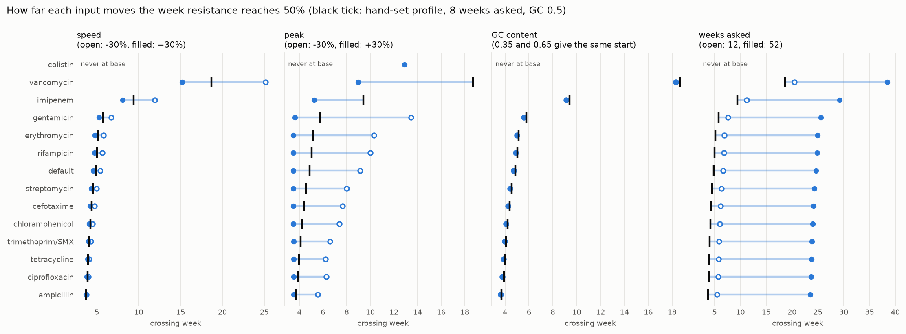
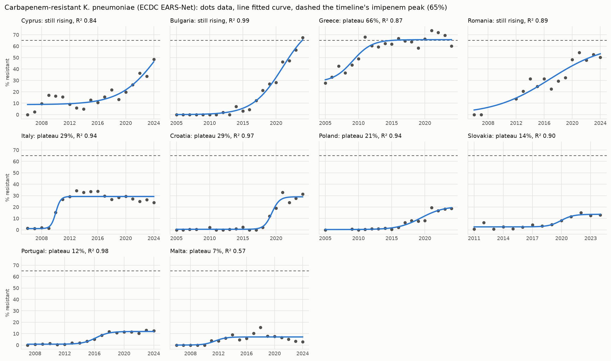
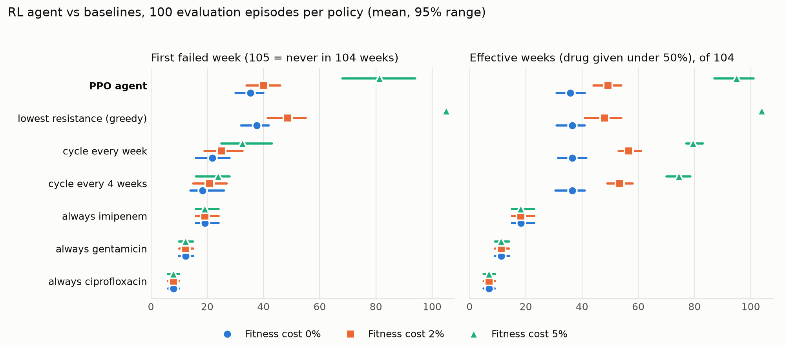

# Chapter: Methodology

*Muhammad Ali Mirza (data and evolution), with the model design by Hamza Afzal. This chapter describes how the models and the simulation work and how they were evaluated; the Results chapter reports what came out. Every experiment is one JSON configuration in `experiments/configs/`, run by `experiments/run.py`, which saves the configuration, metrics, predictions and model under `experiments/results/<run id>/`.*

## 1. The task

The platform answers three questions, one per engine:

| Question | Engine | Kind | Input | Output |
|---|---|---|---|---|
| Will this isolate resist this antibiotic? | **Forecaster** | LightGBM, trained | Antibiotic, organism, MIC if measured | Resistant or Susceptible, with a probability |
| Will this genome resist this antibiotic? | **Genome model** | LightGBM, trained | Genome assembly (FASTA), antibiotic | Resistant or Susceptible, with a probability |
| If we keep treating with this drug, how fast does resistance take over? | **Timeline** | Simulation (not trained), with an RL agent and a timeline ML model beside it | Genome, antibiotic, number of weeks | Week-by-week resistant share, failure week, which drug to give each week |

The first two are **binary classification** of genome-antibiotic pairs: label 1 for Resistant (including Intermediate, Nonsusceptible and Reduced Susceptibility), 0 for Susceptible (Data chapter, section 3). The timeline is a what-if tool and is evaluated differently (sections 7 and 8).

## 2. The split by genome

Each genome is tested against about 20 antibiotics (median 20 rows per genome). If rows are split at random, the same genome sits in training and test, and a model can score well by recognising the genome instead of learning resistance. Every split in this project therefore keeps **all rows of a genome on one side** (`experiments/lib/splits.py`):

| Split | How | Used for |
|---|---|---|
| Test | `StratifiedGroupKFold` with 5 folds, grouped by Genome ID, stratified by the label: one fold (20%) is the test set | Every reported number |
| Encoding folds | 5 grouped folds inside the training set | Out-of-fold target encoding (section 3) |
| Validation | One sixth of the training genomes, grouped | Early stopping, calibration and the threshold (section 4) |
| Lineage split | Groups are clusters of related genomes by 6-mer distance instead of single genomes, cut at three levels (near-identical, close and broad lineages; `experiments/genome/lineage.py`) | Whether relatives inflate the score |
| Genus held out | Train without one genus, test only on it | Transfer to an organism never seen |
| Temporal split | Train on genomes collected up to a year, test on later ones | Transfer to the future |

The split is the most important single choice in the evaluation. The July forecaster, evaluated on a random row split, reported AUC 0.93; on genomes it never saw it scores 0.644 (Results chapter, section 2).

## 3. The forecaster's features and the target-encoding fix

**Features** (14 for the served model `D3_forecaster_deploy_v7`):

| Group | Features |
|---|---|
| Drug | antibiotic, drug class |
| Organism | taxon ID at species level, genus, species |
| Measurement | MIC value, log(1 + MIC), MIC sign, whether an MIC exists |
| Provenance | whether the label is from a laboratory; the F1 score of the computational method (1.0 for lab rows) |
| Resistance rates | the resistant share for this antibiotic; for this organism and antibiotic; for this genus and antibiotic |

The last three are **target encodings**: averages of the label over groups of training rows. They are powerful and dangerous. The original training script computed them on the whole dataset before splitting, so a test row's feature was computed partly from its own label (`experiments/lib/encoders.py`, mode `leaky`). The fix computes them **out of fold**: each training row gets rates computed from the other four encoding folds, never from its own fold; test rows get rates from the whole training set; a group with fewer rows than a minimum (1 for the antibiotic, 3 for organism-antibiotic and genus-antibiotic) falls back to the training mean. Run `A0` keeps the leaky version so its cost can be measured beside `A2`, the corrected one.

## 4. Training, calibration and the threshold

| Choice | Setting | Why |
|---|---|---|
| Algorithm | LightGBM, 63 leaves, learning rate 0.05, at most 500 trees, early stopping after 30 rounds without validation AUC gain | Tree ensembles beat logistic regression; LightGBM, random forest, XGBoost and CatBoost were within 0.003 AUC of each other (Results chapter) |
| Categorical features | Native LightGBM categories, aligned between training and test | No one-hot explosion over 126 drugs |
| Monotone MIC | The predicted risk may only rise with the MIC (`monotone_on: mic_value, mic_log`) | A higher MIC never means more susceptible; the constraint costs nothing measurable |
| Calibration | Isotonic regression on half of the validation genomes | The website shows the probability as a number people read |
| Threshold | On the other half of the validation genomes: the highest threshold (scanning 0.95 down to 0.05) at which at most **10% of resistant isolates are called susceptible** | A missed resistance (very major error) is the costly error; the threshold is never chosen on test rows |

Calibration and threshold are chosen on different validation genomes, so neither is judged on the rows it was fitted to.

## 5. The genome models' features

**k-mer model.** A genome becomes the frequencies of its 256 4-letter DNA words (counts divided by the total, so genomes of different length compare), plus GC content and length in megabases, plus the antibiotic. The counts come from the stored 6-mer counts (Data chapter, section 6); the website computes the same features from an upload, per contig, as in training.

**Gene model.** From the gene matrix, for each genome-antibiotic row (`experiments/genome/genes.py`):

| Feature | Meaning |
|---|---|
| Raw gene columns | 0/1 for every gene or mutation carried by enough genomes (50 in the served model) |
| `gene_class_n`, `mutation_class_n` | Genes and mutations whose AMRFinderPlus class covers this drug's class |
| `gene_class_any` | Either of the above is present |
| `key_determinant` | A named, well-known determinant for this drug is present |
| `amr_genes_total` | Every AMR element in the genome (multidrug load) |
| `efflux_n` | Efflux and multidrug elements, which act on many drugs |
| Antibiotic, drug class | As in the forecaster |

The drug-aware features let one model handle every drug: the same gene matters for a carbapenem row and not for a macrolide row. Genus is left out of the served gene model because an upload does not come with one.

**A rule as the opponent.** To check that a model is needed at all, a lookup rule calls a genome resistant when AMRFinderPlus finds any gene or mutation of the drug's class (`experiments/algorithms/rule_model.py`), scored on the same rows and split.

**Label source.** BV-BRC's computational labels were themselves predicted from the genome, so a genome model could score well on them by re-deriving that prediction. Genome results are quoted on **laboratory rows**.

## 6. Metrics and statistics

| Metric | Definition | Why |
|---|---|---|
| AUC-ROC | Probability that a random resistant row scores above a random susceptible one | Threshold-free ranking quality; the headline number |
| AUC-PR | Area under precision against recall | Informative when one class is rare |
| Very major error (VME) | Resistant rows called susceptible, as a share of resistant rows | The dangerous error: a drug that will fail is recommended |
| Major error (ME) | Susceptible rows called resistant, as a share of susceptible rows | A working drug is withheld |
| Brier score | Mean squared error of the probability | Calibration |
| Sensitivity, specificity, F1, balanced accuracy | At the chosen threshold | The confusion matrix in familiar terms |

**Uncertainty.** Rows of one genome are correlated, so confidence intervals **resample genomes, not rows** (200 bootstrap samples; `metrics.bootstrap_ci`). Two models on the same test rows are compared with the DeLong test for correlated AUCs, McNemar's test on their yes/no calls, and a paired bootstrap over genomes (`experiments/lib/significance.py`, `experiments/compare.py`). Key configurations were rerun with split seeds 42, 1 and 2.

## 7. The timeline simulation

The timeline is a **simulation with hand-set numbers, not a trained model**, and the website says so. For a drug and a number of weeks, the resistant share in week *t* follows a logistic curve (`backend/ml_models/mutation_timeline.py`):

```
R(t) = r0 + (peak − r0) / (1 + exp(−k (t − midpoint)))
```

| Parameter | Value |
|---|---|
| `k` | 2.5 × the drug's `speed`, hand-set from the literature for 13 drugs and a default |
| `peak` | The highest share resistance can reach, hand-set per drug |
| `r0` | Starting share from the genome's GC content: \|GC − 0.5\| × 0.3, kept between 2% and 15% |
| `midpoint` | 0.45 × the number of weeks asked |

Treatment fails in the first week R reaches 50%. Random parts (mutation counts, hotspot mutation types) use one seeded generator, so the same request always gives the same answer.

Two checks were made instead of a training step (`experiments/evolution/`):

1. **Sensitivity analysis** (`sensitivity.py`): `speed` and `peak` scaled from 0.7 to 1.3, four horizons, three GC values, all 14 profiles: 8,232 combinations, each checked against the exact crossing time of the formula. It showed which parameters drive the answer (the horizon most, then `peak`; `speed` much less).

   
2. **Calibration against published curves** (`calibrate.py`): the same logistic curve, with a free midpoint, fitted by non-linear least squares (`scipy.optimize.curve_fit`) to 15 published curves: lab evolution of *E. faecalis* under five drugs (days) and carbapenem-resistant *K. pneumoniae* in 10 countries (years). Parameters are reported with 95% confidence intervals and the fit with RMSE and R².

   

   The fits check the curve's shape; they do not replace the hand-set constants, because no source measures resistance in weeks (lab curves run in days, surveillance in years).

**The timeline ML model** (Hamza Afzal; Results chapter, section 6) answers the same question from data: LightGBM forecasts the yearly resistant share of a genus and antibiotic from the years before, trained on years up to 2016 and tested on 2017 to 2022 against three baselines. The website shows it beside the simulation.

## 8. The RL agent

The supervisor asked whether a learned policy could choose drugs better than fixed rules. The agent is trained on the simulation, not on patient data, and is presented that way.

**Environment** (`experiments/evolution/rl_env.py`, a Gymnasium environment):

| Part | Definition |
|---|---|
| Drugs | Ciprofloxacin, gentamicin, imipenem: three classes with fast, middle and slow resistance in the timeline's profiles; no cross-resistance |
| State | The resistant share for each drug (0 to 1), plus the share of the 104-week horizon gone |
| Action | Which drug to give this week |
| Dynamics | The drug given moves one week along its logistic curve (rate 2.5 × `speed`, varied week to week by log-normal noise, ceiling `peak`); drugs not given lose resistance by a fitness cost (0%, 2% or 5% a week, since the true cost is not known); starting shares drawn between 2% and 10% |
| Reward | − (resistant share of the drug given: the infection it fails to clear) − (the week's total rise in resistance) |
| Failure | A week fails when the drug given **starts** the week at 50% resistance or more |
| Episode | Always the full 104 weeks: ending at the first failure would pay an agent with negative rewards to fail fast |

**Training** (`experiments/evolution/rl_train.py`): PPO from stable-baselines3, a 64-64 MLP policy, 300,000 steps per agent with 8 parallel environments, discount 0.99, entropy bonus 0.01. One agent per fitness cost, each from three training seeds: 9 agents, about 2.7 million simulated weeks.

**Evaluation.** The agent and six baselines (always one of the three drugs; cycling every week or every 4 weeks; greedy: the drug with the lowest resistance now) run on the **same 100 episodes** (seeds 1000 to 1099, never used in training), so they start from the same resistance and meet the same noise. The agent picks its most likely drug each week. Reported per policy: first failed week, effective weeks (the drug given was under 50%), mean burden and total reward, with the 2.5 to 97.5 percentile range; agent minus baseline is computed per episode with a bootstrap interval. The served agent is chosen on separate check episodes (seeds 500 to 549), not on the evaluation set.



*Figure: the PPO agent against the baselines at each fitness cost (`experiments/evolution/rl_figure.py`; numbers in `experiments/evolution/results/rl_agent.md`). The agent beats every fixed schedule; greedy keeps drugs working longest, because the reward has no term for a failed week.*

**Serving.** The website's backend runs without PyTorch, so the agent's policy network (two hidden layers of 64, tanh) is exported as plain arrays and run with numpy (`backend/ml_models/rl_agent.py`), together with a numpy copy of the environment. A test checks that this copy gives exactly the same `rl` block as the training code (`experiments/evolution/test_rl_agent.py`). The agent reads any 1 to 52 week request against its 104-week training horizon.

## 9. Software and reproducibility

| Part | Tools |
|---|---|
| Data and models | Python 3, pandas, NumPy, scikit-learn, LightGBM, SciPy; stable-baselines3, Gymnasium and PyTorch for the RL agent |
| Genome tools | NCBI AMRFinderPlus 4.2.7 (database 2026-08-07.1), in a conda environment and in the backend's Docker image |
| Large jobs | Google Colab reading and writing Google Drive, for downloads and features too large for a laptop |
| Serving | Django REST API (`backend/`), React frontend (`web/`), Docker; the served models are copied from an experiment by `experiments/promote.py` only |

Every run is defined by its configuration and seed and writes a snapshot of both; the cleaned data is cached under its cleaning version; the Colab notebooks in `notebooks/` reproduce the served forecaster and k-mer model exactly from the shared data (AUC 0.7737 and 0.9371).
